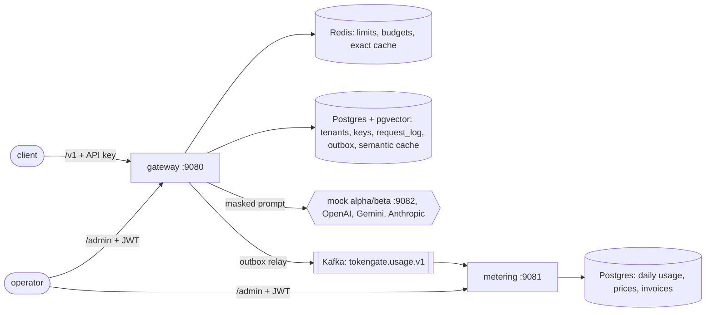

# TokenGate

TokenGate is an LLM API gateway I built to learn the backend problems that sit between an app and a model
provider. It exposes the OpenAI API (`/v1/chat/completions`, including streaming, and `/v1/embeddings`) and
sits in front of OpenAI, Gemini, Anthropic or a local mock. What it does for every tenant:

- rate limits and budgets
- PII masking before anything leaves
- exact and semantic caching
- cost- or latency-aware routing with failover
- usage events through Kafka into a metering service that produces invoices

I work on Java backends at Paytm, and most of what I wanted to practise here has nothing to do with LLMs:

- transactional outbox
- idempotent consumers
- Lua scripts in Redis
- circuit breakers
- SSE backpressure
- keeping a hexagonal codebase honest with tests

The LLM part made it a realistic setting for all of that.

Everything below was run on my machine. Where I haven't measured something, I say so.

## What's verified and what isn't

| Area | Status | Evidence |
|---|---|---|
| Chat, streaming, embeddings against the mock provider | Verified | `scripts/demo.sh`, Newman run, end-to-end tests |
| OpenAI, Gemini, Anthropic adapters | Verified against recorded wire formats only (WireMock). Not called with real keys | `ProviderContractTest` |
| Exact, semantic (MiniLM) and L1 cache | Verified | demo: miss, `l1_hit`, then `semantic_hit` at similarity 0.9955 |
| PII masking (email, +91 phone, PAN, Aadhaar with Verhoeff, cards with Luhn) | Verified | demo: 5 values masked in what the upstream received, then restored in the reply |
| Token bucket rate limit, daily token budget, monthly cost cap | Verified | demo: 429 with `Retry-After: 20`, budget 429 at "96 of 150 tokens" |
| Circuit breaker and failover | Verified | demo: alpha down, 8/8 requests served by beta, alpha's breaker `OPEN` |
| Outbox to Kafka to metering, invoices | Verified | demo usage rows and a `DRAFT` invoice for $0.000096; [request journey](docs/request-journey.md) |
| Admin API with JWT roles | Verified | demo: `BILLING` gets 403 on price changes; Newman |
| Prometheus metrics, Grafana dashboard | Running locally, dashboard provisioned. Not load-tested as a monitoring setup | `ops/` |
| OpenTelemetry traces | Wired, but no collector in the local stack, so I haven't looked at exported spans | `application.yml` |
| Throughput and latency | Single-machine dev numbers only | [docs/benchmark.md](docs/benchmark.md) |
| Hedged requests | Unit-tested, off by default, not exercised in the demo | `FailoverExecutorTest` |
| Multiple gateway replicas | Not tried | |

## How it fits together



A chat request goes through these steps in order:

1. API key auth
2. token bucket
3. PII masking
4. token count (jtokkit, cl100k)
5. cache lookup: L1, then Redis, then pgvector
6. routing and the budget reservation
7. failover with retries
8. settle the reservation and store in the cache
9. `request_log` and the outbox row in one transaction
10. unmask the reply

The details are in [docs/architecture.md](docs/architecture.md). The [request journey](docs/request-journey.md)
follows one real request through every table and topic it touches.

Modules:

- `tokengate-gateway`: the API, plus `/admin` for tenants, keys, providers, routing and budgets.
- `tokengate-metering`: the Kafka consumer, versioned prices and invoices.
- `tokengate-mock-provider`: two fake upstreams with controllable latency, errors and outages.
- `tokengate-common`: the usage event contract.
- `tokengate-arch-rules`: ArchUnit rules for the hexagonal layering.

Design decisions, with the trade-offs I accepted, are in [docs/adr](docs/adr):

1. [Spring MVC on virtual threads instead of WebFlux](docs/adr/0001-mvc-with-virtual-threads.md)
2. [Transactional outbox for usage events](docs/adr/0002-transactional-outbox-for-usage.md)
3. [Fail open when Redis is down](docs/adr/0003-fail-open-on-redis.md)
4. [Budgets enforced in Redis, truth kept in Postgres](docs/adr/0004-budgets-in-redis-truth-in-postgres.md)
5. [What gets retried, what fails over, and hedging](docs/adr/0005-retries-failover-and-hedging.md)
6. [How API keys are stored and looked up](docs/adr/0006-api-key-storage-and-lookup.md)

## Running it

You need Java 21 and Docker. The Maven wrapper is included.

```bash
docker compose up -d                 # Postgres+pgvector, Redis, Kafka, Prometheus, Grafana
scripts/fetch-model.sh               # all-MiniLM-L6-v2 ONNX export into ./models (about 90 MB)
./mvnw -q verify                     # build and run all tests (needs Docker for Testcontainers)
scripts/start.sh                     # mock provider, gateway, metering; logs in /workspace/tokengate-run/logs
scripts/demo.sh | tee /workspace/tokengate-run/demo-output.txt
scripts/newman.sh                    # Postman collection through Newman
bench/run.sh                         # k6 scenarios, needs k6 on PATH
scripts/stop.sh                      # stops only what start.sh started
```

`docker compose --profile apps up` runs the three services in containers too. I mostly used `start.sh`
because it's faster to restart.

To get an admin JWT locally, run `scripts/admin-token.sh ADMIN`. It signs with the dev HMAC secret and is meant
only for local runs.

### Ports

| Service | Host port |
|---|---|
| gateway | 9080 |
| metering | 9081 |
| mock provider | 9082 |
| Postgres | 55442 |
| Redis | 6390 |
| Kafka | 9094 |
| Prometheus | 9091 |
| Grafana | 3300 |

I moved them away from the defaults on purpose, so this stack can run next to my other projects.

### Configuration

Everything is set through environment variables. There are no secrets in the repo. Where a dev default exists, it
has `dev-only` in its value.

| Variable | What it's for |
|---|---|
| `OPENAI_API_KEY`, `GEMINI_API_KEY`, `ANTHROPIC_API_KEY` | Each real provider is registered only if its key is set |
| `TOKENGATE_DB_URL`, `TOKENGATE_DB_USER`, `TOKENGATE_DB_PASSWORD`, `TOKENGATE_DB_POOL` | Gateway database |
| `METERING_DB_URL`, `METERING_DB_USER`, `METERING_DB_PASSWORD` | Metering database |
| `TOKENGATE_REDIS_HOST`, `TOKENGATE_REDIS_PORT` | Redis |
| `TOKENGATE_KAFKA`, `METERING_KAFKA` | Kafka bootstrap servers for each service |
| `TOKENGATE_MOCK_URL` | Base URL of the mock provider |
| `TOKENGATE_API_KEY_PEPPER` | HMAC pepper for API key hashes |
| `TOKENGATE_PII_KEY` | Key for PII placeholder ids |
| `TOKENGATE_JWT_ISSUER_URI` or `TOKENGATE_JWT_HMAC_SECRET` | Admin JWT validation (both services) |
| `TOKENGATE_EMBEDDING_MODEL_DIR` | MiniLM ONNX directory. If unset, the hashing embedder is used |
| `TOKENGATE_HEDGE_AFTER` | e.g. `300ms` to turn on hedging. Off when empty |
| `OTEL_EXPORTER_OTLP_TRACES_ENDPOINT`, `TOKENGATE_TRACE_SAMPLING` | Where to send traces, and the sample rate |
| `PORT`, `METERING_PORT` | HTTP ports |

## Embeddings and tokenizer

The semantic cache embeds prompts with **all-MiniLM-L6-v2** (sentence-transformers), exported to ONNX and run in
process with ONNX Runtime. The output is 384-dimensional vectors, stored in pgvector and compared with cosine
distance. I wrote the WordPiece tokenizer for it myself. `EmbeddingProvidersTest` checks the splitting and that the real
model puts paraphrases closer together than unrelated text.

If the model directory isn't configured, the gateway falls back to a feature-hashing embedder. It only catches word
overlap, not meaning, and the gateway logs a warning at startup when it is in use. The demo, the benchmark and the
request journey all ran with MiniLM; the startup line is at the top of `demo-output.txt`.

Token counts use **jtokkit** with the `cl100k_base` encoding. That's exact for OpenAI's older models and only an
estimate for Gemini and Anthropic. The gateway estimates before the call to reserve budget, then reconciles against
the usage the provider reports.

## Data structures I wrote by hand

| Where | Structure | Why |
|---|---|---|
| `LruTtlCache` | HashMap + doubly linked list, lazy TTL | O(1) get/put/evict for the in-process L1 cache |
| `SmoothWeightedRoundRobin` | nginx's smooth WRR | Spreads weighted picks evenly instead of in bursts |
| `Ewma` | Exponentially weighted moving average on an `AtomicLong` (double bits), CAS loop | Lock-free latency tracking for latency routing |
| `CircuitBreaker` | Ring buffer of the last N outcomes, closed, open and half-open | Count-based failure rate with O(1) updates |
| `ConsistentHashRing` | `TreeMap` with 128 virtual nodes per provider | Sticky routing that moves few users when a provider leaves |
| `AhoCorasick` | Trie with failure links | One pass over the prompt for any number of custom deny terms |
| `TokenBucket` (+ `token_bucket.lua`) | Lazy refill on read | No background refill thread; the Lua version is atomic in Redis |
| `Luhn`, `Verhoeff` | Luhn mod 10; Verhoeff with dihedral group D5 tables | Keeps card and Aadhaar masking from firing on random digit runs |
| `StreamingUnmasker` | Small hold-back buffer | Restores PII placeholders split across SSE chunks |
| `RetryPolicy` | Exponential backoff with full jitter | Avoids synchronised retry storms |

## Tests

`./mvnw -q verify` runs **201 tests, 0 failures, 0 skipped** (last run on 2026-10-27). They cover:

- **Unit tests** for the domain: routing, breaker, EWMA, ring, LRU, PII scanner and checksums, prices, invoices.
- **Application tests** for `ChatService`, `FailoverExecutor` and `StreamSession` with fakes. These cover failover
  order, which failures are retried, hedging, and mid-stream failure and cancel.
- **Testcontainers integration tests**: 20 across both services. They run against real Postgres+pgvector, Redis and
  Kafka and cover the Lua scripts, the semantic cache query, the ledger and invoice SQL, and two end-to-end suites.
- **WireMock contract tests** for the OpenAI, Gemini and Anthropic adapters (15 tests). They cover request mapping,
  response and stream parsing, and error classification.
- **Concurrency tests**: parallel hits on the token bucket and on the Redis Lua scripts, and concurrent invoice
  upserts.
- **ArchUnit**: the hexagonal layering in each service.

## What's missing

These are the gaps I know about:

- **No dead-letter topic.** A usage event that metering can't parse is logged with its offset and skipped. When the
  database is down, the consumer retries forever and stalls instead of skipping usage.
- **The semantic lookup doesn't use the HNSW index.** Because of the tenant and context filter, Postgres does an
  exact scan over that tenant's rows. That's fine at demo sizes and gets slow with a large tenant.
  [docs/benchmark.md](docs/benchmark.md) has the numbers and the fixes I'd try.
- **No reconciliation between Redis and Postgres.** If Redis loses its budget keys, nothing rebuilds them from
  `request_log`. While Redis is down, the gateway fails open (ADR 3), so tenants can go over budget.
- **Outbox and `request_log` grow forever.** There is no retention job yet.
- **Key changes can lag.** A revoked key keeps working for up to 30 s because of the lookup cache, and the pepper
  can't be rotated.
- **Costs differ slightly between services.** The gateway rounds cost to micro-dollars; metering keeps the exact
  value.
- **No log line per request.** Errors are logged, but there's no INFO line with the request id for successful
  requests.
- **Metering's 401 and 403 responses have an empty body** instead of a problem document.
- **Kafka has no volume in compose.** Restarting the container loses the topic, which the outbox makes survivable.
- **Untested at scale.** Streaming wasn't benchmarked, I haven't run more than one gateway replica, and I haven't
  called the real providers with real keys.

## Resume notes

These are the bullets I'd take from this project. A number in [X] means I haven't measured it.

- I built an OpenAI-compatible LLM gateway in Java 21 and Spring Boot 3: 5 Maven modules, hexagonal layering
  checked by ArchUnit. It routes between providers by cost, latency (EWMA), weight (smooth WRR), priority or
  consistent hashing, with per-provider circuit breakers and jittered retries.
- I added a three-level cache: an in-process LRU+TTL, Redis, and pgvector with MiniLM ONNX embeddings. On one dev
  machine, cache hits served 4,072 req/s at 8.6 ms p95 (L1) and 940 req/s at 33 ms p95 (semantic), compared with
  208 req/s for full misses (k6, 20 VUs). Hit rate on real traffic: [X].
- I found a pgvector query that re-parsed the probe vector for every row during load testing. Moving it into a
  CTE took miss throughput from 77.6 to 208 req/s and p95 from 531 ms to 184 ms on the same machine.
- I built PII masking for Indian identifiers before prompts leave the gateway: Aadhaar validated with Verhoeff,
  PAN, +91 phones, cards validated with Luhn. It has reversible tokenisation and stream-safe unmasking.
- I implemented per-tenant rate limits and token and cost budgets as atomic Redis Lua scripts. They reserve before
  the call, reconcile after it, and return 429 with `Retry-After` and `RateLimit` headers.
- I set up usage metering with a transactional outbox, Kafka and an idempotent consumer, using versioned prices
  and monthly invoices. Covered by 201 tests, including 20 Testcontainers integration tests and 15 WireMock
  contract tests. Events lost under failure: [X], not fault-injected beyond the demo.

## License

MIT. See [LICENSE](LICENSE).
