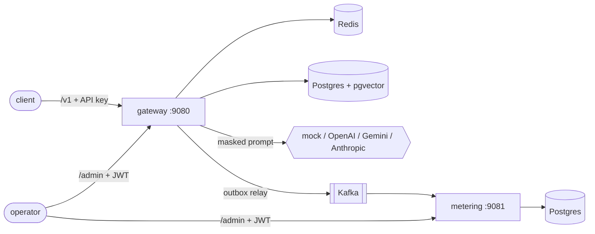

# TokenGate

An LLM gateway written in Java 21 / Spring Boot 3. Apps talk to it using the OpenAI API format and it forwards
the call to OpenAI, Gemini, Anthropic or a local mock, depending on how the tenant's routing is set up.

I mainly built it to work on the boring-but-hard backend parts: rate limiting in Redis, an outbox that doesn't
lose usage events, failover that doesn't retry things it shouldn't, and streaming without blocking threads.
The LLM side just made it a realistic place to do that.

What it handles per tenant:

- API keys, rate limits, daily token budgets and a monthly cost cap
- masking PII (email, +91 phone, PAN, Aadhaar, card numbers) before the prompt leaves, and putting it back in the reply
- caching: in-memory, exact match in Redis, and semantic match in pgvector
- routing by cost, latency, weight, priority or sticky hash, with a circuit breaker per provider
- usage events to Kafka, and a metering service that aggregates them and builds monthly invoices

## Layout

```
tokengate-gateway        /v1 API + /admin (tenants, keys, providers, routing, budgets)
tokengate-metering       Kafka consumer, price versions, invoices
tokengate-mock-provider  two fake upstreams (alpha, beta) with latency/error/outage switches
tokengate-common         usage event shared by gateway and metering
tokengate-arch-rules     ArchUnit rules for the ports/adapters layering
```



Order of things for a chat request: key check, token bucket, PII masking, token count, cache lookup
(L1, Redis, pgvector), pick a provider and reserve budget, call with failover, settle the reservation,
write `request_log` + outbox row in the same transaction, unmask the reply.

More detail in [docs/architecture.md](docs/architecture.md), and [docs/request-journey.md](docs/request-journey.md)
follows one real request through every table and topic. Design choices are written up in [docs/adr](docs/adr)
(MVC on virtual threads vs WebFlux, outbox, failing open on Redis, where budgets live, retry/failover rules,
API key storage).

## Running locally

Needs Java 21 and Docker.

```bash
docker compose up -d        # postgres+pgvector, redis, kafka, prometheus, grafana
scripts/fetch-model.sh      # downloads all-MiniLM-L6-v2 (onnx, ~90 MB) into ./models
./mvnw -q verify            # tests, Testcontainers needs Docker
scripts/start.sh            # mock provider, gateway, metering
scripts/demo.sh             # walks through the main features
scripts/newman.sh           # runs the Postman collection
bench/run.sh                # k6, needs k6 installed
scripts/stop.sh
```

`scripts/admin-token.sh ADMIN` gives you a local admin JWT (signed with a dev secret, local use only).
Postman collection and environment are in [docs/postman](docs/postman).

Ports are shifted off the defaults so it doesn't clash with my other stuff: gateway 9080, metering 9081,
mock 9082, Postgres 55442, Redis 6390, Kafka 9094, Prometheus 9091, Grafana 3300.

All config is env vars, nothing secret is committed. Real providers are only registered if
`OPENAI_API_KEY` / `GEMINI_API_KEY` / `ANTHROPIC_API_KEY` is set. The full list is in the `application.yml` files.

## Embeddings and token counting

Semantic cache uses all-MiniLM-L6-v2 through ONNX Runtime, in process (384-dim vectors, cosine distance in
pgvector). I wrote the WordPiece tokenizer for it. If the model isn't there it falls back to a feature-hashing
embedder, which only matches on word overlap, and logs a warning at startup.

Token counts come from jtokkit (`cl100k_base`). Exact for older OpenAI models, an estimate for the others.
The gateway reserves on the estimate and corrects it with what the provider reports back.

## Hand-written pieces

A few things I wrote myself instead of pulling in a library, mostly because I wanted to understand them:

- `LruTtlCache`: hash map + doubly linked list, O(1) get/put, lazy expiry
- `SmoothWeightedRoundRobin`: the nginx algorithm, spreads weighted picks instead of bursting
- `Ewma`: latency average kept in an `AtomicLong` with a CAS loop
- `CircuitBreaker`: ring buffer of the last N calls, closed / open / half-open
- `ConsistentHashRing`: `TreeMap` with 128 virtual nodes per provider, for sticky routing
- `AhoCorasick`: for custom deny terms in a single pass
- `TokenBucket` and `token_bucket.lua`: lazy refill, the Lua one runs atomically in Redis
- `Luhn`, `Verhoeff`: so card/Aadhaar masking doesn't trigger on any random run of digits
- `StreamingUnmasker`: holds back a few chars so placeholders split across SSE chunks still get restored
- `RetryPolicy`: exponential backoff with full jitter

## Tests

`./mvnw -q verify` runs 201 tests. Besides unit tests there are 20 Testcontainers tests against real
Postgres/pgvector, Redis and Kafka, 15 WireMock contract tests for the provider adapters, some concurrency
tests on the token bucket, Lua scripts and invoice upserts, and ArchUnit checks on every service.

The provider adapters have only been tested against recorded request/response formats, not with real keys.

## Benchmarks

Rough numbers from k6 on my dev machine are in [docs/benchmark.md](docs/benchmark.md). They're single-machine
numbers against the mock provider, so treat them as a comparison between code paths, not capacity.
The most useful thing that came out of it was a pgvector query that was re-parsing the query vector on every
row; fixing it is written up there too.

## Known gaps

- no dead-letter topic: a bad usage event is logged and skipped, and if the metering DB is down the consumer just keeps retrying
- the semantic lookup does an exact scan per tenant instead of using the HNSW index (fine for small tenants)
- nothing rebuilds Redis budgets from Postgres, and the gateway fails open when Redis is down, so a tenant can overspend
- no retention job for the outbox and `request_log`
- revoked keys can still work for up to 30s (lookup cache), and the key pepper can't be rotated yet
- gateway rounds cost to micro-dollars, metering keeps the exact value
- metering returns empty 401/403 bodies instead of problem+json
- Kafka has no volume in compose
- haven't run more than one gateway instance, benchmarked streaming, or looked at exported traces (no collector set up)

## License

MIT
