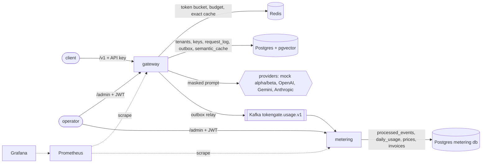

# Architecture

## Services

| Module | Port | What it does |
|---|---|---|
| `tokengate-gateway` | 9080 | The OpenAI-compatible `/v1` API: auth, limits, PII masking, caching, routing, failover, streaming, usage outbox. Also serves `/admin` for tenants, keys, providers and routing. |
| `tokengate-metering` | 9081 | Consumes usage events, aggregates per tenant, day, model and provider, keeps versioned prices, builds monthly invoices. |
| `tokengate-mock-provider` | 9082 | Two fake upstreams, `alpha` and `beta`, that speak the OpenAI wire format. A control API sets latency, error rate, outages and mid-stream failures, and records what each upstream received. |
| `tokengate-common` | - | The `UsageEvent` contract shared by gateway and metering. |
| `tokengate-arch-rules` | - | ArchUnit rules that every service module runs as a test. |

Infrastructure comes from `docker-compose.yml`: Postgres 16 with pgvector (`tokengate` and `tokengate_metering`
databases), Redis 7.2, Kafka 3.8 in KRaft mode, Prometheus and Grafana. Host ports are moved off the defaults
(55442, 6390, 9094, 9091, 3300) so this stack can run next to other projects.

## Inside the gateway

The layout is hexagonal and `HexagonalRules` enforces it at test time:

- `domain`: plain Java, no Spring, no I/O. Token bucket, circuit breaker, EWMA, smooth weighted round robin,
  consistent-hash ring, LRU+TTL cache, the PII scanner (Luhn, Verhoeff, Aho-Corasick), prices and costs.
- `application`: the use cases (`ChatService`, `FailoverExecutor`, `ResponseCache`, `Admission`, `OutboxRelay`,
  admin services) and the outbound ports they need (`ChatProvider`, `RateLimiter`, `BudgetLedger`,
  `SemanticCacheStore`, `EmbeddingProvider`, `OutboxStore`, ...).
- `adapter.in`: web controllers, the API key filter, the RFC 7807 problem handler.
- `adapter.out`: Redis, JDBC and pgvector, Kafka, HTTP providers, ONNX embeddings, jtokkit, Micrometer.
- `config`: wiring only.

The rules: the domain depends on nothing outside itself and the JDK; the application depends on the domain and its
own ports, never on adapters or Spring web; adapters don't depend on each other.

### A non-streaming request

1. The API key filter resolves the tenant (prefix lookup, HMAC compare; ADR 6).
2. The rate limiter takes a token from the Redis token bucket. A 429 carries `Retry-After` and `RateLimit-*`.
3. PII masking runs on every message. A tenant chooses `TOKENIZE` (reversible per request), `REDACT` or `OFF`.
4. jtokkit counts the masked prompt's tokens.
5. The cache decides whether this request is cacheable at all. Streamed requests, and requests with temperature
   above 0, bypass the cache unless the tenant has opted in. If it is cacheable: L1, then Redis exact, then
   pgvector semantic.
6. On a miss, the router builds a plan from the providers whose breakers would let a call through, using the
   tenant's policy: `COST`, `LATENCY` (EWMA), `WEIGHTED` (SWRR), `PRIORITY` or `STICKY` (consistent hash on `user`).
   Then the budget reservation is taken.
7. `FailoverExecutor` walks the plan with the retry rules in ADR 5, optionally hedging.
8. The reservation is settled to actual usage, the response is cached, `request_log` and `outbox` are written in one
   transaction, and the response is unmasked for this caller only.

A cache hit still records usage (provider `cache`, cost 0), so metering counts hits.

### Streaming

`POST /v1/chat/completions` with `"stream": true` returns `text/event-stream` in OpenAI's chunk format. Everything
that can still fail as a normal HTTP error happens before the 200 goes out: limits, routing, and opening the upstream
stream, including failover. After that:

- If upstream fails before any content has been sent, the next provider is tried and the client never sees it.
- If upstream fails after content has been sent, the gateway sends an SSE `error` event and no `[DONE]`. Tokens
  streamed so far are billed.
- If the client disconnects, the upstream is closed at the next write. Tokens streamed so far are billed.
- If the upstream goes silent for 20 s (the idle watchdog), the gateway handles it as an upstream failure.
- PII tokens split across chunks are reassembled before unmasking (`StreamingUnmasker`), holding back at most one
  token's worth of characters.

### Semantic cache

- The default embedding is all-MiniLM-L6-v2 exported to ONNX (384 dims), run in process with ONNX Runtime and a
  hand-written WordPiece tokenizer. If no model directory is configured, a feature-hashing embedder takes over. It
  is lexical, not semantic, and the gateway logs a warning at startup when it is used.
- Entries are scoped by tenant and by a context key. The context key is a hash of the model, the request
  parameters and every message except the last user message. Only that last user message is embedded and compared,
  so a near-duplicate question inside a different conversation doesn't count as a hit.
- Only masked prompts are embedded and stored. A hit created from another caller's prompt can contain PII tokens
  that this request's masking session doesn't know about. Those tokens are left masked, never resolved.
- Each tenant sets its own threshold (default 0.9) and TTL (default 1 h). Expired rows are purged by a background
  job.

## Metering

- `UsageEventListener` deserialises each event. `UsageIngestion` prices it with the `PriceVersion` in effect on the
  event's date. In one transaction, it inserts into `processed_events` (the primary key is the dedup) and upserts
  `daily_usage`.
- An event for a model with no price is still counted, as an `unpriced_requests` count with no cost.
- `POST /admin/invoices` builds or rebuilds a `DRAFT` invoice for a tenant and month from `daily_usage`. `issue`
  freezes it; an issued invoice can't be rebuilt (409).
- Prices are append-only versions with an `effective_from` date, so a price change never rewrites history.

## Security

- `/v1/**` takes API keys only. `/admin/**` on both services takes JWTs only (resource server, HS256 locally or
  an issuer URI). Roles: `ADMIN` (everything), `VIEWER` (GET), `BILLING` (budgets, usage, invoices).
- No secret is in the repo. Provider keys, the pepper, the PII HMAC key, the JWT secret and DB passwords are read
  from the environment. The dev defaults are labelled `dev-only` and exist only so the stack starts locally.
- A real provider adapter is only registered when its key env var (`OPENAI_API_KEY`, `GEMINI_API_KEY`,
  `ANTHROPIC_API_KEY`) is set.

## Observability

- Micrometer metrics on `/actuator/prometheus`. Gateway metrics: `tokengate_provider_latency_seconds`,
  `tokengate_cache_lookups_total`, `tokengate_tokens_total`, `tokengate_cost_usd_total`,
  `tokengate_rejections_total`, `tokengate_failovers_total`, `tokengate_pii_masked_total`,
  `tokengate_streams_total`, `tokengate_breaker_state`, `tokengate_usage_record_failures_total`, plus the standard
  HTTP, JVM, Hikari and Kafka metrics.
- `ops/grafana/dashboards/tokengate-overview.json` is provisioned into Grafana on port 3300.
- OpenTelemetry tracing through Micrometer Tracing. Spans are exported over OTLP when
  `OTEL_EXPORTER_OTLP_TRACES_ENDPOINT` is set.
- JSON logs with the trace id and the request id in MDC.
- Errors are `application/problem+json` with a `urn:tokengate:problem:*` type.
- OpenAPI docs at `/swagger-ui.html` (springdoc).
- `/actuator/health/liveness` and `/actuator/health/readiness` probes; graceful shutdown with a 25 s drain.
